# 

## **CEBU INSTITUTE OF TECHNOLOGY**

**UNIVERSITY**

COLLEGE OF COMPUTER STUDIES

# 

# 

## 

## 

# **Software Design Description**

## *for*

## TB-XR: AI-Assisted Tele-Radiology Screening and Longitudinal Monitoring System

**Change History Signature**

| Version | Date | Authors | Description of Revision |
| :---- | :---- | :---- | :---- |
| 1.0 | April 25, 2026 | Borgonia, J.D.; Emia, S.N.; Enario, L.J.L.; Epan, R.S.; Tolentino, B. | Initial Release SDD for TB-XR |
| 2.0 | October 28, 2026 | Borgonia, J.D.; Emia, S.N.; Enario, L.J.L.; Epan, R.S.; Tolentino, B. | Comprehensive update to as-built architecture across all 4 modules without adding extra sub-modules. Maintained strict 12 sub-module structure (1.1–1.3, 2.1–2.3, 3.1–3.3, 4.1–4.3). Corrected all class diagrams to include complete class names, attributes (with explicit types), and operations (with parameters and return types). Corrected all sequence diagrams to match active API contracts, image quality gating, review concurrency locks, structured diagnostic reporting, longitudinal progression override audit logging, and analytical exports. Converted data design specifications into Crow's Foot ER diagrams matching relational schemas across all 12 sub-modules. Removed obsolete base64 artifacts and synchronized domain entities. |

**Preface**

This Software Design Description (SDD) provides a formal, comprehensive architectural and detailed structural specification for the TB-XR system. Designed in accordance with IEEE Std 1016-2009 (Standard for Information Technology — Systems Design — Software Design Descriptions), this document translates the functional, performance, security, and interface requirements established in the Software Requirements Specification (SRS) into concrete, verified software architectures, object-oriented class hierarchies, sequence diagrams, and relational database schemas.

---

**Table of Contents**

- [1. Introduction](#1-introduction)
  - [1.1 Purpose](#11-purpose)
  - [1.2 Scope](#12-scope)
  - [1.3 Definitions, Acronyms, and Abbreviations](#13-definitions-acronyms-and-abbreviations)
  - [1.4 References](#14-references)
  - [1.5 Document Conventions](#15-document-conventions)
- [2. Architectural Design](#2-architectural-design)
  - [2.1 Architectural Overview & Layered Structure](#21-architectural-overview--layered-structure)
  - [2.2 High-Level System Architecture Diagram](#22-high-level-system-architecture-diagram)
  - [2.3 Overall Domain Entity Class Diagram](#23-overall-domain-entity-class-diagram)
- [3. Detailed Design: System Modules](#3-detailed-design-system-modules)
  - [Module 1: X-ray Ingestion and Data Management](#module-1-x-ray-ingestion-and-data-management)
    - [1.1 Upload Chest X-ray for TB Risk Screening](#11-upload-chest-x-ray-for-tb-risk-screening)
    - [1.2 Automated Image Standardization](#12-automated-image-standardization)
    - [1.3 Centralized Patient Profiling and Storage](#13-centralized-patient-profiling-and-storage)
  - [Module 2: Annotation and Diagnostic Review](#module-2-annotation-and-diagnostic-review)
    - [2.1 Remote Access Queue](#21-remote-access-queue)
    - [2.2 Interactive Annotation](#22-interactive-annotation)
    - [2.3 Diagnostic Submission](#23-diagnostic-submission)
  - [Module 3: AI Engine and Longitudinal Monitoring](#module-3-ai-engine-and-longitudinal-monitoring)
    - [3.1 AI Baseline Risk Scoring](#31-ai-baseline-risk-scoring)
    - [3.2 Historical Record Retrieval](#32-historical-record-retrieval)
    - [3.3 Comparative Logic and Progression Tracking](#33-comparative-logic-and-progression-tracking)
  - [Module 4: Clinical Dashboards and Reporting](#module-4-clinical-dashboards-and-reporting)
    - [4.1 Role-Based Access and Authentication](#41-role-based-access-and-authentication)
    - [4.2 Role-Specific Dashboards and Transaction Tracking](#42-role-specific-dashboards-and-transaction-tracking)
    - [4.3 Consolidated Report Generation](#43-consolidated-report-generation)
- [4. Cross-Cutting Design Concerns](#4-cross-cutting-design-concerns)
  - [4.1 Transaction and Entity Lifecycles](#41-transaction-and-entity-lifecycles)
  - [4.2 Concurrency Management & Review Lock Protocol](#42-concurrency-management--review-lock-protocol)
  - [4.3 Role-Based Access Control (RBAC) Matrix](#43-role-based-access-control-rbac-matrix)
  - [4.4 Ethical AI and Clinical Safeguards](#44-ethical-ai-and-clinical-safeguards)
- [5. Appendix: System API Endpoint Catalog](#5-appendix-system-api-endpoint-catalog)

---

# 1. Introduction

## 1.1 Purpose
This document defines the detailed design of the TB Chest X-ray classification and tele-radiology system to ensure consistent and accurate implementation across all system modules. It specifies the system architecture, component interactions, data flow, object-oriented class structures, sequence diagrams, and design constraints to eliminate ambiguity during development and enable complete traceability between system requirements and implementation.

This document is intended for developers, system architects, clinical evaluators, and test automation engineers involved in the development, integration, and validation of the system.

## 1.2 Scope
The system covers the design and implementation of a web-based TB Chest X-ray screening tool that classifies input radiographs as high-risk or low-risk using a lightweight deep learning model, supports remote radiologist review and annotation, enables deterministic longitudinal progression tracking, and generates structured diagnostic reports.

The system is organized into the following four primary modules without extraneous sub-modules:
* **Module 1: X-ray Ingestion and Data Management** (Upload screening, image standardization, centralized patient profiling, and image quality checking)
* **Module 2: Annotation and Diagnostic Review** (Remote access queue, concurrency-safe review locking, interactive multi-shape annotation canvas, and structured diagnostic submission)
* **Module 3: AI Engine and Longitudinal Monitoring** (AI baseline scoring, Grad-CAM visual heatmaps, historical record retrieval, comprehensive PDF report generation, and comparative progression tracking with manual overrides)
* **Module 4: Clinical Dashboards and Reporting** (Role-based authentication, role-specific operational dashboards, in-system notifications, consolidated analytics reporting, and automated backup infrastructure)

The system is engineered to operate efficiently on low-resource clinical environments and standard web browsers.

### Exclusions from Scope
* Autonomous clinical diagnosis or final medical decision-making without a licensed human clinician in the loop (HITL).
* Bi-directional HL7/FHIR hospital information system (HIS) protocol brokers.
* Distributed continuous model re-training pipelines in production.
* Medical device regulatory compliance certification (e.g., FDA Class II or DOH approval).

## 1.3 Definitions, Acronyms, and Abbreviations
* **AI:** Artificial Intelligence.
* **AUC:** Area Under the Curve, a measure of classification performance.
* **CHW:** Channel, Height, Width tensor layout format `(C, H, W)`.
* **CLAHE:** Contrast Limited Adaptive Histogram Equalization, a localized image processing technique used to prevent noise over-amplification while highlighting lung opacities.
* **CNN:** Convolutional Neural Network, deep neural network architecture used for image analysis.
* **CXR:** Chest X-Ray radiograph.
* **DICOM:** Digital Imaging and Communications in Medicine, the standard format for medical imaging (`.dcm`).
* **DRF:** Django REST Framework.
* **Grad-CAM:** Gradient-weighted Class Activation Mapping, generating visual explanation heatmaps highlighting regions influencing CNN decisions.
* **HITL:** Human-in-the-Loop, clinical workflow model requiring human medical validation before treatment actions.
* **JPEG/PNG:** Joint Photographic Experts Group / Portable Network Graphics standard image formats.
* **MobileNetV3:** Lightweight convolutional neural network architecture optimized for efficient inference.
* **NPY:** NumPy binary container format used for persisting preprocessed tensors.
* **RBAC:** Role-Based Access Control, restricting system actions based on assigned user roles.
* **SDD:** Software Design Description (IEEE Std 1016-2009).
* **SPA:** Single Page Application.
* **SRS:** Software Requirements Specification.
* **TB:** Tuberculosis (*Mycobacterium tuberculosis* pulmonary infection).
* **TB-XR:** Name of the collaborative teleradiology platform specified herein.
* **UUID:** Universally Unique Identifier (RFC 4122).

## 1.4 References
1. IEEE Std 1016-2009, *IEEE Standard for Information Technology — Systems Design — Software Design Descriptions*.
2. IEEE Std 830-1998, *IEEE Recommended Practice for Software Requirements Specifications*.
3. T. Rahman et al., "Reliable Tuberculosis Detection Using Chest X-Ray With Deep Learning, Segmentation and Visualization," in *IEEE Access*, vol. 8, pp. 191586–191601, 2020. doi: 10.1109/ACCESS.2020.3031384.
4. R. R. Selvaraju et al., "Grad-CAM: Visual Explanations from Deep Networks via Gradient-Based Localization," in *Int. J. Comput. Vis.*, vol. 128, no. 2, pp. 336–359, 2020.
5. World Health Organization, *Chest radiography in tuberculosis detection — summary of current WHO recommendations and guidance on programmatic approaches*, Geneva: WHO, 2016.
6. TB-XR Project Software Requirements Specification (`documentation/refactored-SRS.md`), 2026.
7. TB-XR Endpoints Specification (`backend/ENDPOINTS.md`), 2026.

## 1.5 Document Conventions
- **UML 2.5 Compliance:** Every object-oriented class diagram explicitly details three compartments: Class Name (with stereotype), Attributes (with visibility and types), and Operations (with visibility, parameters, and return types).
- **Visibility Markers:** Public (`+`), Protected (`#`), Private (`-`), Static (`$`).
- **Pathing and Links:** All source file references follow forward-slash conventions matching workspace roots.

---

# 2. Architectural Design

## 2.1 Architectural Overview & Layered Structure
TB-XR utilizes a multi-tiered, decoupled client-server architecture organized into four primary operational layers:

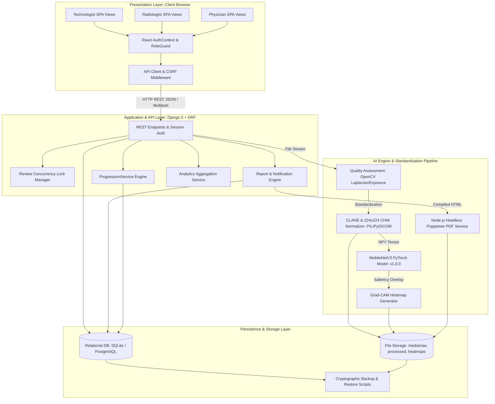

1. **Client Presentation Layer (Frontend):** React 18 SPA built with Vite, styled with Tailwind CSS, utilizing `AuthContext` for session management and `RoleGuard` for role-based navigation.
2. **Application / API Layer (Backend):** Django 5 and Django REST Framework providing authenticated REST endpoints, session security, CSRF protection, `@role_required` access controls, and business logic services.
3. **AI Engine & Imaging Pipeline Layer:** Python/PyTorch sub-system executing image quality checks, DICOM parsing, CLAHE standardization, MobileNetV3 inference, Grad-CAM heatmap rendering, and Puppeteer headless PDF generation.
4. **Data Persistence & Storage Layer:** Relational database (SQLite/PostgreSQL) storing master clinical models, file system storage for raw/processed images and heatmaps, and automated cryptographic backup utilities.

---

## 2.2 High-Level System Architecture Diagram

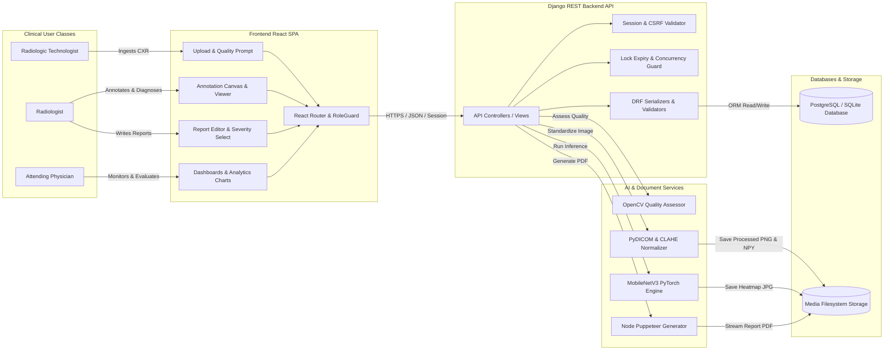

---

## 2.3 Overall Domain Entity Class Diagram
The core domain model is structured around 10 primary entities spanning user identity, clinical master data, image processing transactions, AI outputs, diagnostic reports, notifications, and progression audit histories.

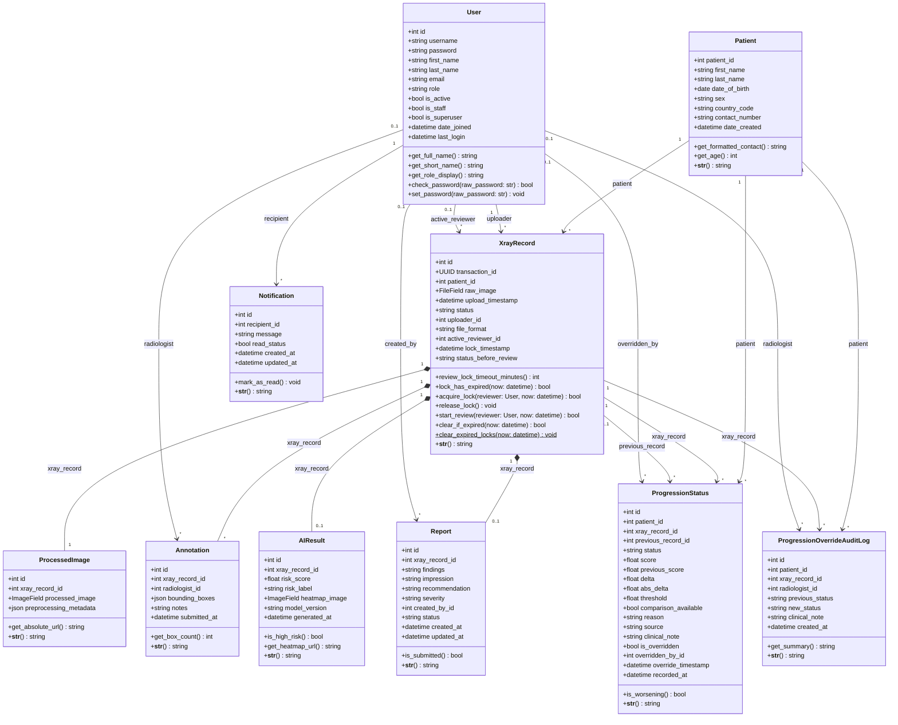

---

# 3. Detailed Design: System Modules

## Module 1: X-ray Ingestion and Data Management

### 1.1 Upload Chest X-ray for TB Risk Screening

#### User Interface Design
Radiologic technologists select a patient from `PatientsPage`, navigate to `PatientDetailPage`, and click "Upload X-ray". The upload modal (`XrayUploadForm`) validates file type (`.png`, `.jpg`, `.jpeg`, `.dcm`) and file size (maximum 50MB), provides an immediate visual preview for standard image types, and initiates upload progress. 

Integrated into this ingestion step is the **Image Quality Gate**: if the image fails algorithmic quality checks (< 0.60 threshold due to blur, underexposure, overexposure, or low contrast), `XrayUploadForm` halts automated inference and displays an informative warning dialog with the detected defect reasons. The technologist is prompted to either re-upload or click "Proceed Anyway" (`force_proceed=True`). Upon successful ingestion, `UploadConfirmation` displays the assigned transaction UUID, acquisition timestamp, and status.

#### Front-End Component(s)
| Component Name | Description and Purpose | Component Type / Format |
| :--- | :--- | :--- |
| `PatientsPage` | Registered patient directory with search and intake triggers. | React Page (`JSX`) |
| `PatientDetailPage` | Profile view displaying demographic card, CXR history, and upload trigger. | React Page (`JSX`) |
| `XrayUploadForm` | Drag-and-drop file ingestion modal with validation, quality feedback, and force-proceed bypass. | React Component (`JSX`) |
| `UploadConfirmation` | Renders transaction UUID, receipt timestamp, and case status. | React Component (`JSX`) |
| `SuccessBanner` | Container displaying upload success messaging. | React Component (`JSX`) |
| `ErrorBanner` | Alert container displaying quality gate failure reasons and bypass options. | React Component (`JSX`) |

#### Back-End Component(s)
| Component Name | Description and Purpose | Component Type / Format |
| :--- | :--- | :--- |
| `upload_xray` | Multipart upload handler executing validation, quality assessment, and record creation. | DRF API View (`POST /api/imaging/patients/<patient_id>/xray/upload/`) |
| `XrayRecordUploadSerializer` | Validates file extensions (`dcm`, `png`, `jpg`), size limit (50MB), and initializes records. | DRF Serializer |
| `assess_quality` | Evaluates exposure, contrast, resolution, and Laplacian blur variance against 0.60 threshold. | Python Utility (`ai/scripts/quality.py`) |
| `XrayRecord` | Master entity recording transaction UUID, raw media path, format, and status. | Django Model (`ORM`) |
| `ProcessedImage` | Child entity holding enhanced standard image and tensor paths. | Django Model (`ORM`) |

#### Object-Oriented Components

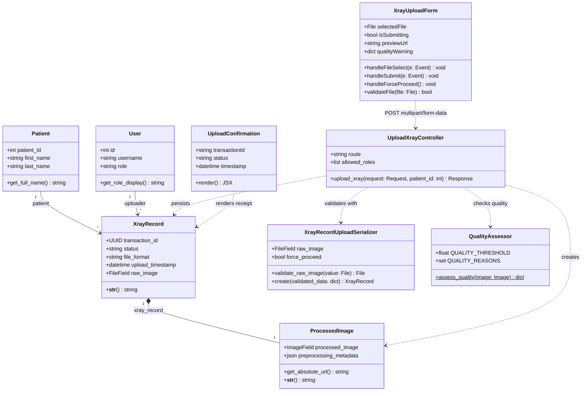

#### Sequence Diagram

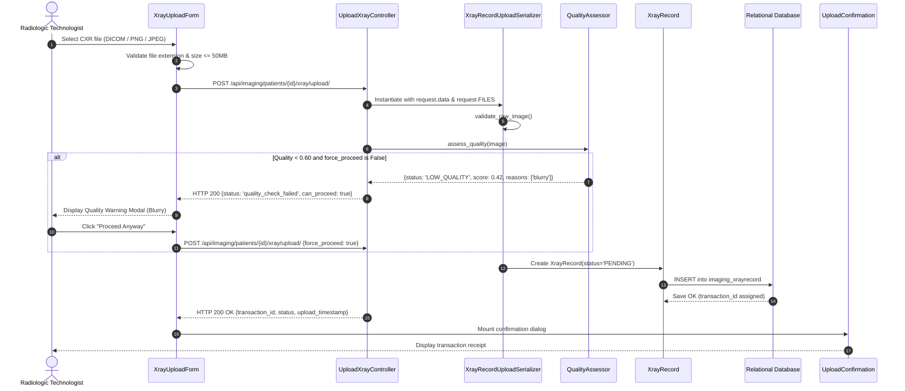

#### Data Design

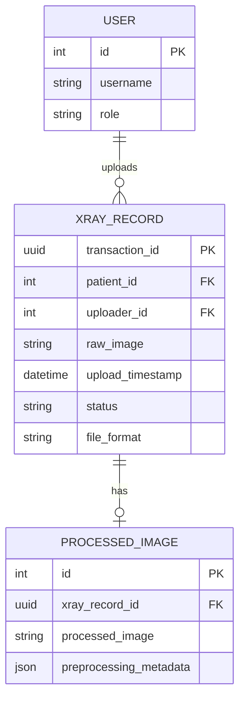

- **Table:** `imaging_xrayrecord`
  - `id` (int, Primary Key, Auto-increment)
  - `transaction_id` (UUID, Unique, Indexed)
  - `patient_id` (int, Foreign Key -> `patients_patient.patient_id`, CASCADE)
  - `raw_image` (varchar(255), File path relative to `media/raw/`)
  - `upload_timestamp` (datetime, auto_now_add=True)
  - `status` (varchar(20), Choices: `PENDING`, `IN_REVIEW`, `AI_REVIEWED`, `MANUAL_REVIEW`, `COMPLETED`)
  - `uploader_id` (int, Foreign Key -> `accounts_user.id`, CASCADE)
  - `file_format` (varchar(10), e.g., 'jpg', 'png', 'dcm')

---

### 1.2 Automated Image Standardization

#### User Interface Design
Standardization is an autonomous server-side pipeline that executes automatically during upload. Visual progress indicators in `XrayUploadForm` confirm standardization before the record transitions to review readiness.

#### Front-End Component(s)
| Component Name | Description and Purpose | Component Type / Format |
| :--- | :--- | :--- |
| `UploadConfirmation` | Displays standardization completion state. | React Component (`JSX`) |

#### Back-End Component(s)
| Component Name | Description and Purpose | Component Type / Format |
| :--- | :--- | :--- |
| `preprocess_xray` | Medical imaging utility converting raw radiographs to 224x224 RGB ImageNet tensors. | Python Utility (`apps/imaging/preprocessing.py`) |
| `ProcessedImage` | Child model holding the enhanced PNG file and preprocessing metadata JSON. | Django Model (`ORM`) |

#### Object-Oriented Components

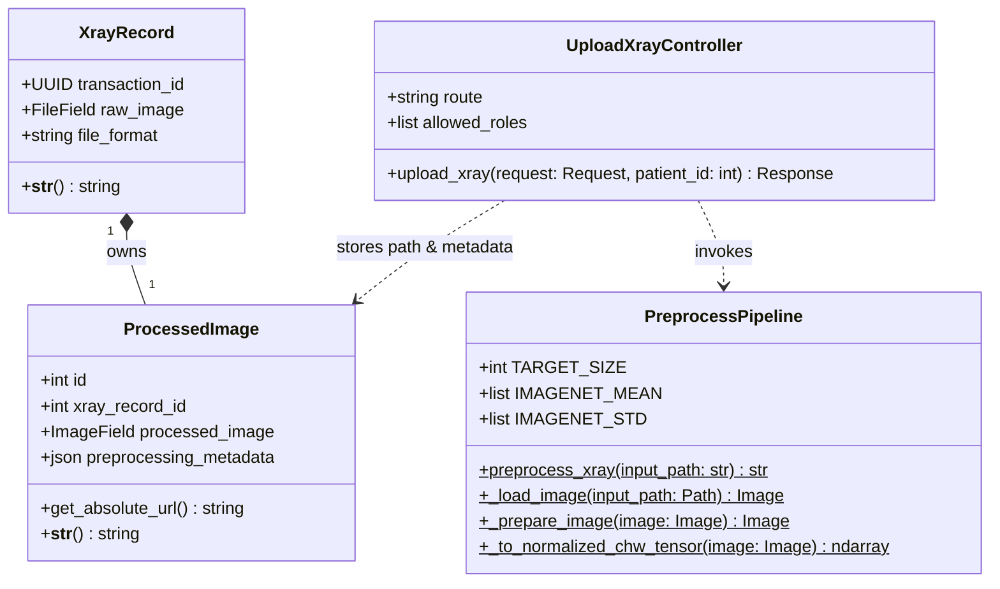

#### Sequence Diagram

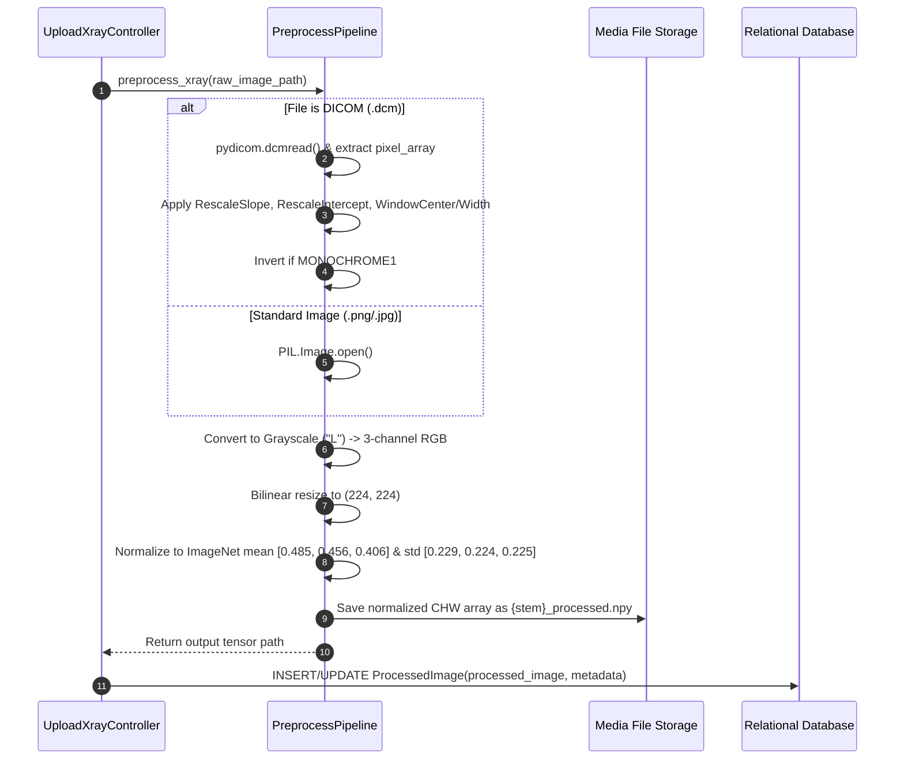

#### Data Design

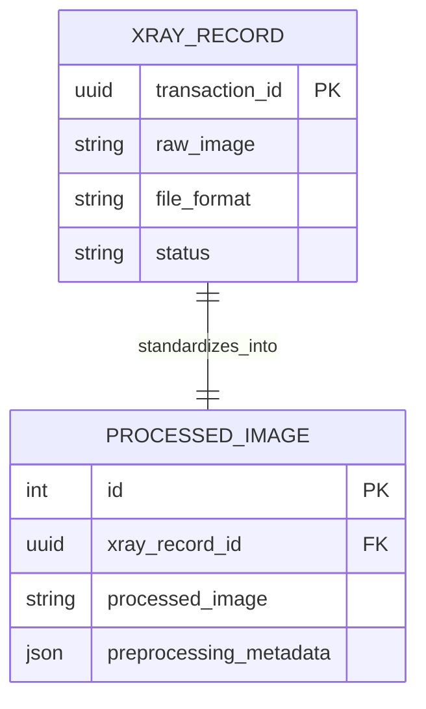

- **Table:** `imaging_processedimage`
  - `id` (int, Primary Key, Auto-increment)
  - `xray_record_id` (int, One-to-One Foreign Key -> `imaging_xrayrecord.id`, CASCADE)
  - `processed_image` (varchar(255), File path relative to `media/xray_processed/`)
  - `preprocessing_metadata` (json, Stores source format, CLAHE parameters, `ai_tensor_path`, `ai_tensor_ready`)

---

### 1.3 Centralized Patient Profiling and Storage

#### User Interface Design
The `PatientsPage` interface provides a searchable master patient list with pagination, real-time debounced search across names and numeric IDs, and a patient registration modal (`PatientCard`). Technologists submit demographics using `PatientForm`. Phone numbers are parsed and formatted into international E.164 notation. `PatientProfileCard` displays patient identity headers across diagnostic and review screens.

#### Front-End Component(s)
| Component Name | Description and Purpose | Component Type / Format |
| :--- | :--- | :--- |
| `PatientsPage` | Master directory view with search and registration triggers. | React Page (`JSX`) |
| `PatientTable` | Tabular display of registered patients with row-level routing. | React Component (`JSX`) |
| `PatientSearchBar` | Live debounce search filter matching first/last names or patient ID. | React Component (`JSX`) |
| `PatientCard` | Dialog container wrapping the patient intake form. | React Component (`JSX`) |
| `PatientForm` | Validated demographic intake form (Name, DOB, Sex, Country, Phone). | React Component (`JSX`) |
| `PatientProfileCard` | Read-only demographic card displaying patient identity. | React Component (`JSX`) |

#### Back-End Component(s)
| Component Name | Description and Purpose | Component Type / Format |
| :--- | :--- | :--- |
| `register_patient` | Creates a new patient record (Restricted to `RADIOLOGIC_TECH`). | DRF API View (`POST /api/patients/register/`) |
| `patient_detail` | Retrieves single patient demographic record by primary key. | DRF API View (`GET /api/patients/<patient_id>/`) |
| `search_patients` | Case-insensitive multi-field search across first name, last name, and ID. | DRF API View (`GET /api/patients/search/?name=`) |
| `patient_list` | Returns all patients ordered by last name, first name. | DRF API View (`GET /api/patients/`) |
| `PatientCreateSerializer` | Validates demographics and normalizes phone numbers to E.164. | DRF Serializer |
| `PatientSerializer` | Serializes complete patient records with international phone formatting. | DRF Serializer |
| `Patient` | Master patient domain entity. | Django Model (`ORM`) |

#### Object-Oriented Components

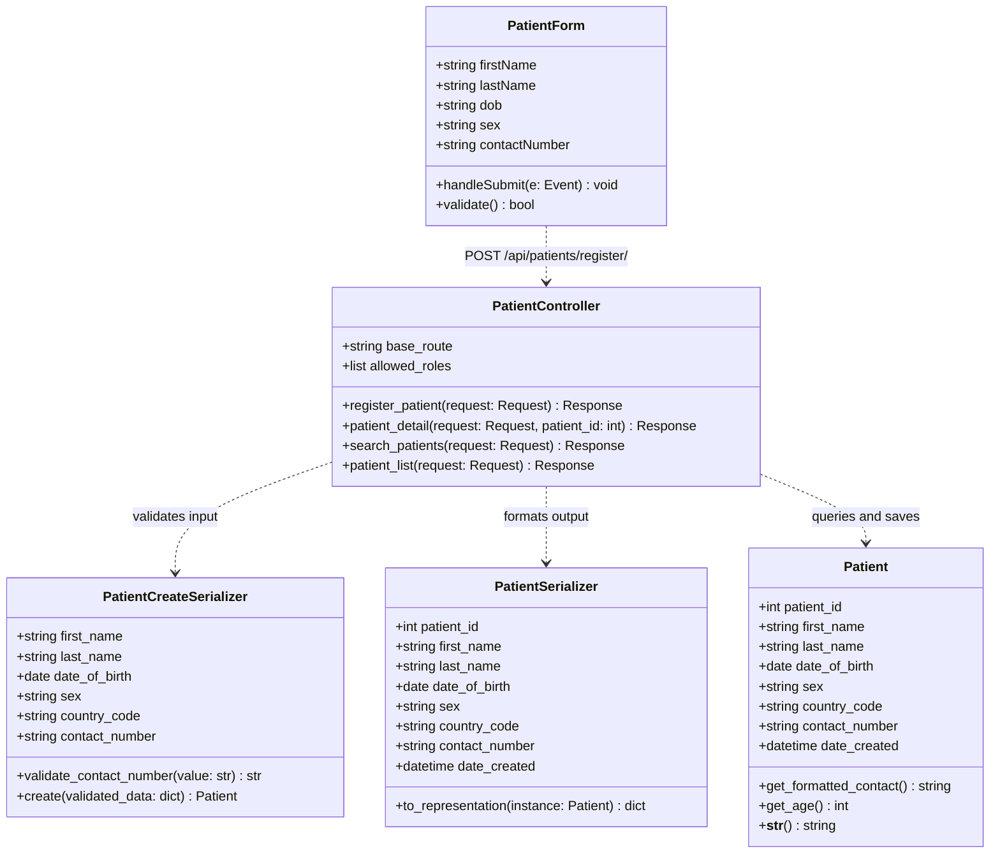

#### Sequence Diagram

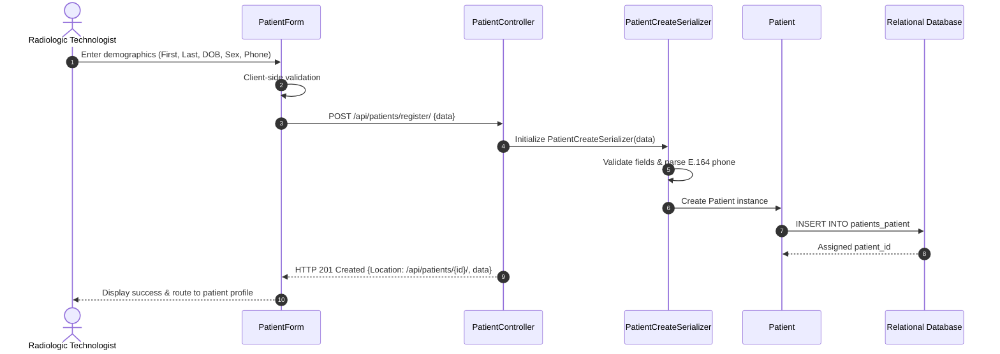

#### Data Design

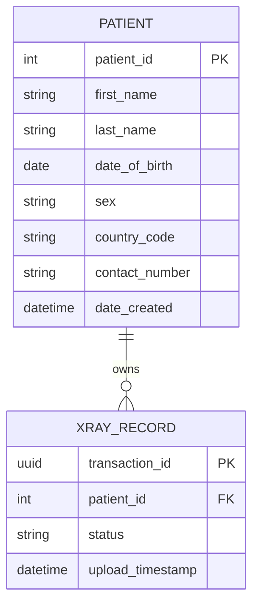

- **Table:** `patients_patient`
  - `patient_id` (int, Primary Key, Auto-increment)
  - `first_name` (varchar(100), Not Null)
  - `last_name` (varchar(100), Not Null)
  - `date_of_birth` (date, Not Null)
  - `sex` (varchar(1), Choices: `M`, `F`, `O`, Not Null)
  - `country_code` (varchar(2), Default: 'PH')
  - `contact_number` (varchar(20), Stored in E.164 international format)
  - `date_created` (datetime, auto_now_add=True)

---

## Module 2: Annotation and Diagnostic Review

### 2.1 Remote Access Queue

#### User Interface Design
The `RadiologistDashboardPage` renders a paginated, sortable worklist (`RadiologistDashboardTable`) displaying cases awaiting radiologist evaluation. The queue provides full-text search across patient names and transaction UUIDs, status filtering (`PENDING`, `IN_REVIEW`, `AI_REVIEWED`, `MANUAL_REVIEW`, `COMPLETED`), and AI risk categorization badges (`LOW`, `MODERATE`, `HIGH`). Stale review locks older than 60 minutes are automatically cleared upon worklist access. Selecting "Review" initiates a concurrency-safe review session.

#### Front-End Component(s)
| Component Name | Description and Purpose | Component Type / Format |
| :--- | :--- | :--- |
| `RadiologistDashboardPage` | Worklist controller managing pagination, debounced search, and status filters. | React Page (`JSX`) |
| `RadiologistDashboardTable` | Renders queue rows, patient identifiers, AI risk badges, and review links. | React Component (`JSX`) |
| `FilterBar` | Search input, status dropdown, and AI risk label filter controls. | React Component (`JSX`) |
| `AIRiskBadge` | Visual indicator reflecting AI-assigned risk tiers (Green/Amber/Red). | React Component (`JSX`) |

#### Back-End Component(s)
| Component Name | Description and Purpose | Component Type / Format |
| :--- | :--- | :--- |
| `radiologist_queue` | Worklist endpoint returning paginated records with expired lock purging. | DRF API View (`GET /api/imaging/queue/`) |
| `RadiologistQueueSerializer` | Serializes records, patient demographics, uploader identities, and AI results. | DRF Serializer |
| `XrayRecord` | Domain model providing lock status and query filtering scopes. | Django Model (`ORM`) |

#### Object-Oriented Components

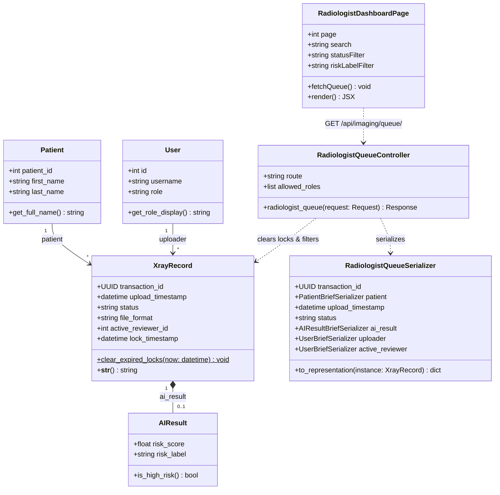

#### Sequence Diagram

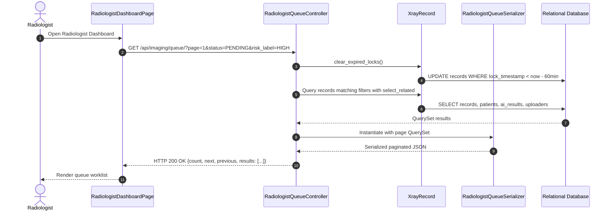

#### Data Design

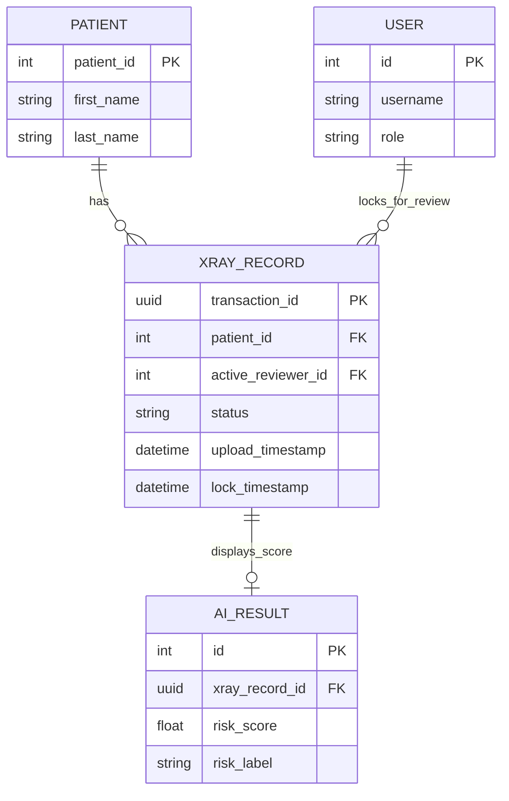

Data is drawn from `imaging_xrayrecord` joined with `patients_patient`, `accounts_user`, and `imaging_airesult`. Query filtering utilizes indexes on `upload_timestamp`, `status`, and `active_reviewer_id`.

---

### 2.2 Interactive Annotation

#### User Interface Design
`AnnotationCanvas` overlay allows radiologists to draw vector annotations directly on the high-resolution radiograph. Supported drawing tools include bounding boxes (rectangles), ellipses (circles), and freehand paths. Users can select shapes, assign radiological labels (e.g., "Infiltrate", "Cavitation", "Nodule"), delete selected elements, and execute multi-level undo operations. Annotations are saved via the `AnnotationPanel`.

Integrated into this workflow is **Concurrency-Safe Review Locking**: when a radiologist opens a case, the system attempts to acquire an exclusive lock via `start_review()`. If another radiologist currently holds the active lock, the server responds with HTTP 409 Conflict. `AnnotationReviewPage` detects this and renders a persistent warning banner indicating the current lock holder, disabling all drawing tools and report editing controls (read-only mode). The lock is automatically renewed during active review and released upon case exit.

#### Front-End Component(s)
| Component Name | Description and Purpose | Component Type / Format |
| :--- | :--- | :--- |
| `AnnotationReviewPage` | Master container orchestrating viewer, canvas, lock heartbeats, and report panels. | React Page (`JSX`) |
| `XrayViewer` | Renders radiograph with hardware-accelerated zoom and pan controls. | React Component (`JSX`) |
| `AnnotationCanvas` | Vector drawing surface capturing rectangles, circles, and freehand strokes. | React Component (`JSX`) |
| `AnnotationPanel` | Annotation list manager displaying labels, notes, and delete actions. | React Component (`JSX`) |
| `StaticAnnotationOverlay` | Read-only vector overlay for read-only and historical inspection modes. | React Component (`JSX`) |
| `ErrorBanner` | Alert banner notifying radiologist when a case is locked by another clinician. | React Component (`JSX`) |

#### Back-End Component(s)
| Component Name | Description and Purpose | Component Type / Format |
| :--- | :--- | :--- |
| `xray_detail` | Case retrieval endpoint attempting review lock acquisition; returns 409 on conflict. | DRF API View (`GET /api/imaging/xray/<id>/`) |
| `annotate_xray` | Persists or updates radiologist bounding boxes and descriptive notes. | DRF API View (`POST /api/imaging/xray/<id>/annotate/`) |
| `renew_review_lock` | Extends review lock timestamp for the active reviewer. | DRF API View (`POST /api/imaging/xray/<id>/lock/renew/`) |
| `release_review_lock` | Releases lock and restores pre-review status upon case exit. | DRF API View (`POST /api/imaging/xray/<id>/lock/release/`) |
| `AnnotationSerializer` | Validates JSON geometry array structure and label strings. | DRF Serializer |
| `Annotation` | Domain model storing annotation geometries linked to X-ray transactions. | Django Model (`ORM`) |
| `XrayRecord` | Manages review lock acquisition, conflict validation, and status restoration. | Django Model (`ORM`) |

#### Object-Oriented Components

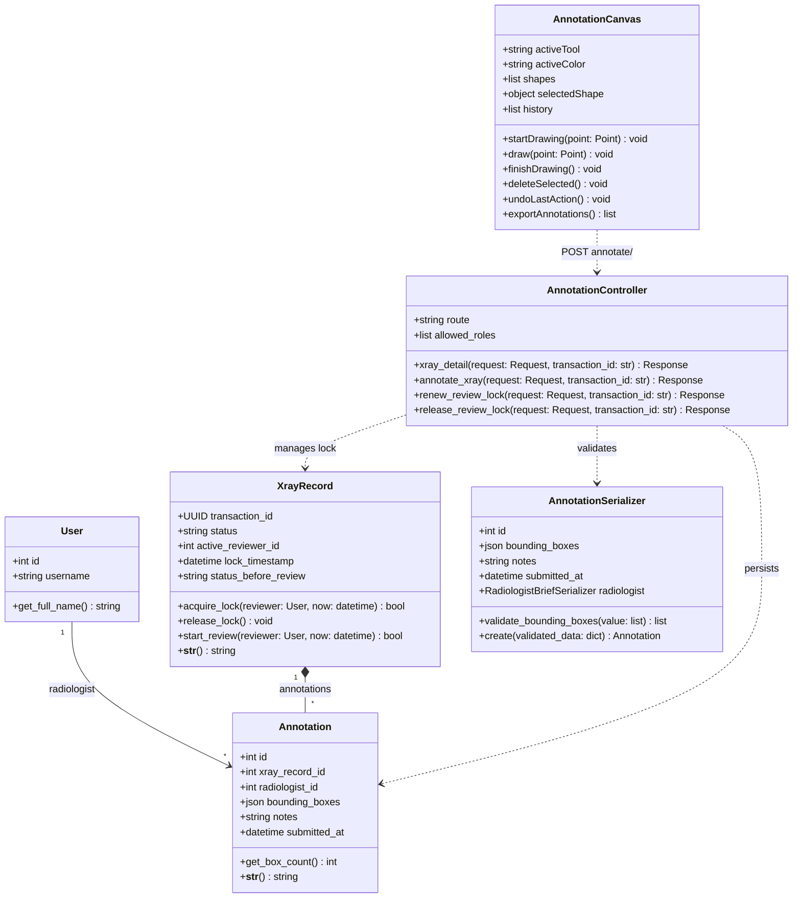

#### Sequence Diagram

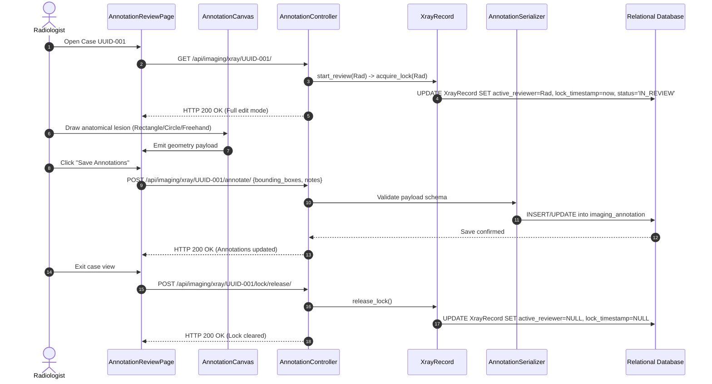

#### Data Design

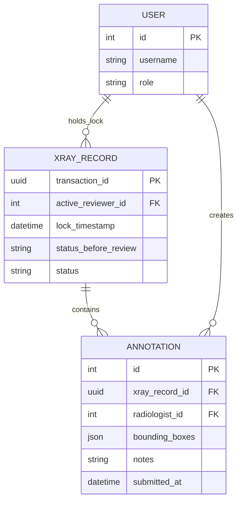

- **Table:** `imaging_annotation`
  - `id` (int, Primary Key, Auto-increment)
  - `xray_record_id` (int, Foreign Key -> `imaging_xrayrecord.id`, CASCADE)
  - `radiologist_id` (int, Foreign Key -> `accounts_user.id`, SET_NULL, Null=True)
  - `bounding_boxes` (json, Array of objects containing: `x`, `y`, `width`, `height`, `tool`, `label`, `stroke_color`)
  - `notes` (text, Optional clinical observations)
  - `submitted_at` (datetime, auto_now_add=True)
- Lock fields on `imaging_xrayrecord`:
  - `active_reviewer_id` (int, Foreign Key -> `accounts_user.id`, Null=True)
  - `lock_timestamp` (datetime, Null=True)
  - `status_before_review` (varchar(20), Null=True)

---

### 2.3 Diagnostic Submission

#### User Interface Design
`ReportWritePage` provides a structured clinical reporting interface enforcing radiological reporting standards. It partitions input into four standardized clinical sections: Findings, Impression, Recommendation, and Severity Classification (`NORMAL`, `MILD`, `MODERATE`, `SEVERE`, `CRITICAL`). 

Radiologists can save incomplete progress using "Save Draft" (`status='DRAFT'`). When ready for final sign-off, clicking "Finalize & Submit" triggers strict validation: all four fields are mandatory. Upon successful submission, the report becomes immutable (`status='SUBMITTED'`), `XrayRecord.status` transitions to `COMPLETED`, the active review lock is released, and an automated alert is created in the physician notification center.

#### Front-End Component(s)
| Component Name | Description and Purpose | Component Type / Format |
| :--- | :--- | :--- |
| `ReportWritePage` | Structured diagnostic report editor supporting draft and submit actions. | React Page (`JSX`) |
| `SelectField` | Standardized dropdown selector for clinical severity categories. | React Component (`JSX`) |
| `SuccessBanner` | Renders case completion receipt with link back to dashboard. | React Component (`JSX`) |
| `ErrorBanner` | Displays field validation error feedback on submission attempt. | React Component (`JSX`) |

#### Back-End Component(s)
| Component Name | Description and Purpose | Component Type / Format |
| :--- | :--- | :--- |
| `report_detail` | Endpoint supporting GET, POST (Draft creation), and PATCH (Draft update / Final submit). | DRF API View (`GET/POST/PATCH /api/imaging/xray/<id>/report/`) |
| `_trigger_report_submission_notification` | Generates an unread `Notification` record for attending physicians. | Python Service Function |
| `ReportCreateSerializer` | Serializes draft report creation without mandatory non-empty constraints. | DRF Serializer |
| `ReportSerializer` | Serializes complete report instances with validation on final submit. | DRF Serializer |
| `Report` | Domain entity storing structured findings, impression, recommendations, and status. | Django Model (`ORM`) |
| `XrayRecord` | Master entity transitioned to `COMPLETED` on final submission. | Django Model (`ORM`) |
| `Notification` | In-system alert entity routed to physician upon report finalization. | Django Model (`ORM`) |

#### Object-Oriented Components

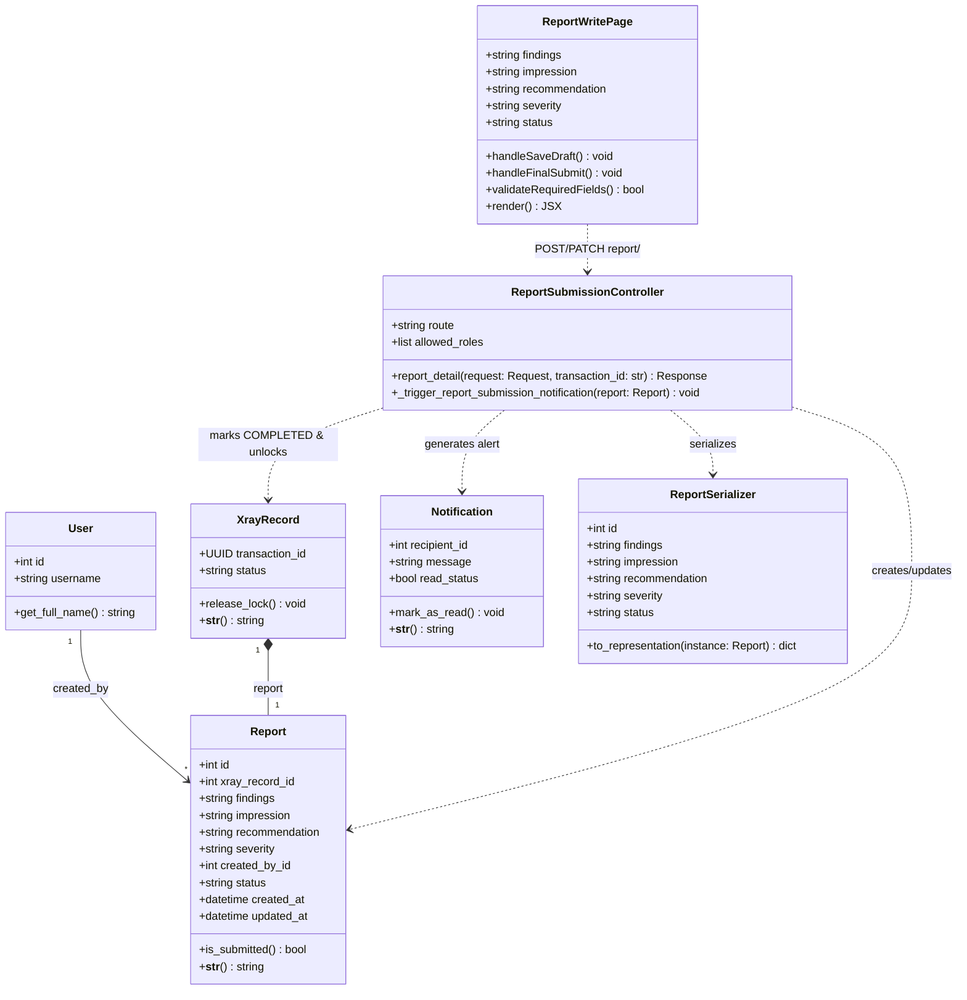

#### Sequence Diagram

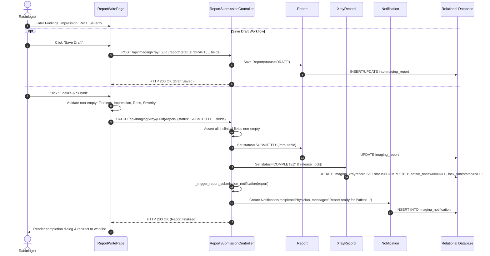

#### Data Design

```mermaid
erDiagram
    XRAY_RECORD {
        uuid transaction_id PK
        string status
        int active_reviewer_id FK
    }

    REPORT {
        int id PK
        uuid xray_record_id FK
        int created_by_id FK
        string findings
        string impression
        string recommendation
        string severity
        string status
        datetime created_at
        datetime updated_at
    }

    USER {
        int id PK
        string username
        string role
    }

    NOTIFICATION {
        int id PK
        int recipient_id FK
        string message
        boolean read_status
        datetime created_at
    }

    XRAY_RECORD ||--o| REPORT : "documents"
    USER ||--o{ REPORT : "authors"
    USER ||--o{ NOTIFICATION : "receives"
```

- **Table:** `imaging_report`
  - `id` (int, Primary Key, Auto-increment)
  - `xray_record_id` (int, One-to-One Foreign Key -> `imaging_xrayrecord.id`, CASCADE)
  - `findings` (text, Detailed radiological observations)
  - `impression` (text, Diagnostic synthesis/impression)
  - `recommendation` (text, Recommended follow-up or treatment)
  - `severity` (varchar(20), Choices: `NORMAL`, `MILD`, `MODERATE`, `SEVERE`, `CRITICAL`)
  - `created_by_id` (int, Foreign Key -> `accounts_user.id`, SET_NULL, Null=True)
  - `status` (varchar(20), Choices: `DRAFT`, `SUBMITTED`, Default: `DRAFT`)
  - `created_at` (datetime, auto_now_add=True)
  - `updated_at` (datetime, auto_now=True)
- **Table:** `imaging_notification`
  - `id` (int, Primary Key, Auto-increment)
  - `recipient_id` (int, Foreign Key -> `accounts_user.id`, CASCADE)
  - `message` (text, Notification message body)
  - `read_status` (boolean, Default: False)
  - `created_at` (datetime, auto_now_add=True)
  - `updated_at` (datetime, auto_now=True)

---

## Module 3: AI Engine and Longitudinal Monitoring

### 3.1 AI Baseline Risk Scoring

#### User Interface Design
AI baseline risk scores are surfaced across the system. In the radiologist queue, an `AIRiskBadge` indicates `LOW` (< 0.50) or `HIGH` (>= 0.50) probability. Within `XrayViewer`, an interactive toggle activates `HeatmapViewer`, which renders a pseudo-colored Grad-CAM visual overlay highlighting suspicious pulmonary opacities. Cases marked `MANUAL_REVIEW` display a "Re-run Analysis" button.

#### Front-End Component(s)
| Component Name | Description and Purpose | Component Type / Format |
| :--- | :--- | :--- |
| `XrayViewer` | Renders base CXR and coordinates Grad-CAM heatmap toggling. | React Component (`JSX`) |
| `HeatmapViewer` | Alpha-blended Grad-CAM visual saliency heatmap overlay. | React Component (`JSX`) |
| `AIRiskBadge` | Visual indicator rendering numerical probability and risk tier. | React Component (`JSX`) |
| `AIScoreLegend` | Reference legend defining clinical risk score boundaries. | React Component (`JSX`) |

#### Back-End Component(s)
| Component Name | Description and Purpose | Component Type / Format |
| :--- | :--- | :--- |
| `_run_ai_inference` | Core execution harness loading model checkpoint, executing forward pass, and computing Grad-CAM. | Python Service (`apps/imaging/views.py`) |
| `predict` | Model wrapper handling tensor normalization and sigmoid output. | Python Script (`ai/scripts/inference.py`) |
| `analyse_xray` | Endpoint triggering on-demand inference re-runs (supports `force_proceed`). | DRF API View (`POST /api/imaging/xray/<id>/analyse/`) |
| `AIResult` | Domain entity storing risk score, risk label, heatmap file path, and version string. | Django Model (`ORM`) |

#### Object-Oriented Components

```mermaid
classDiagram
    class XrayRecord {
        +UUID transaction_id
        +string status
        +__str__() string
    }

    class AIResult {
        +int id
        +int xray_record_id
        +float risk_score
        +string risk_label
        +ImageField heatmap_image
        +string model_version
        +datetime generated_at
        +is_high_risk() bool
        +get_heatmap_url() string
        +__str__() string
    }

    class AIResultSerializer {
        +float risk_score
        +string risk_label
        +string heatmap_url
        +string model_version
        +datetime generated_at
        +get_heatmap_url(obj: AIResult) string
    }

    class MobileNetV3Model {
        +string MODEL_VERSION
        +string MODEL_NAME
        +load_model()$ nn.Module
        +forward(tensor: Tensor) Tensor
    }

    class GradCAMGenerator {
        +string colormap
        +generate_heatmap(model: Module, tensor: Tensor, orig_image: Image)$ ndarray
    }

    class InferenceService {
        +int image_size
        +predict(image_path: str, force_proceed: bool, transaction_id: str)$ dict
    }

    class AIController {
        +string route
        +list allowed_roles
        +analyse_xray(request: Request, transaction_id: str) Response
        +_run_ai_inference(record: XrayRecord, force_proceed: bool, notify_on_failure: bool) dict
    }

    XrayRecord "1" *-- "0..1" AIResult : ai_result
    AIController ..> InferenceService : invokes
    InferenceService ..> MobileNetV3Model : loads weights
    InferenceService ..> GradCAMGenerator : computes saliency
    AIController ..> AIResult : saves output
    AIController ..> AIResultSerializer : serializes
```

#### Sequence Diagram

```mermaid
sequenceDiagram
    autonumber
    participant Controller as AIController
    participant InfService as InferenceService
    participant PyTorch as MobileNetV3Model
    participant GradCAM as GradCAMGenerator
    participant FS as Media File Storage
    participant DB as Relational Database

    Controller->>InfService: predict(processed_image_path, transaction_id)
    InfService->>PyTorch: Load weights (v1.0.0 deploy_model.pth)
    InfService->>PyTorch: Execute forward pass with normalized CHW tensor
    PyTorch-->>InfService: Logit output -> Sigmoid probability (0.923)
    InfService->>GradCAM: Compute gradients from classifier layer
    GradCAM->>GradCAM: Generate feature map overlay & apply cv2.COLORMAP_JET
    GradCAM->>FS: Write heatmap to media/heatmaps/{uuid}_heatmap.jpg
    InfService-->>Controller: Return {risk_score: 0.923, risk_label: 'HIGH', heatmap_path}
    Controller->>DB: INSERT/UPDATE into imaging_airesult
    Controller->>DB: UPDATE imaging_xrayrecord SET status='AI_REVIEWED'
```

#### Data Design

```mermaid
erDiagram
    XRAY_RECORD {
        uuid transaction_id PK
        string status
        datetime upload_timestamp
    }

    AI_RESULT {
        int id PK
        uuid xray_record_id FK
        float risk_score
        string risk_label
        string heatmap_image
        string model_version
        datetime generated_at
    }

    XRAY_RECORD ||--o| AI_RESULT : "generates"
```

- **Table:** `imaging_airesult`
  - `id` (int, Primary Key, Auto-increment)
  - `xray_record_id` (int, One-to-One Foreign Key -> `imaging_xrayrecord.id`, CASCADE)
  - `risk_score` (float, Range: 0.0000 - 1.0000)
  - `risk_label` (varchar(10), Choices: `LOW`, `MODERATE`, `HIGH`)
  - `heatmap_image` (varchar(255), Path relative to `media/heatmaps/`, Null=True)
  - `model_version` (varchar(64), e.g., 'v1.0.0')
  - `generated_at` (datetime, auto_now_add=True)

---

### 3.2 Historical Record Retrieval

#### User Interface Design
The `PatientDetailPage` provides clinicians with chronological access to all historical radiographs for a selected patient via `XrayRecordList`. Each record card displays the acquisition timestamp, assigned transaction UUID, AI score badge, and review status. Selecting a history item opens `XrayViewer` with associated annotations and finalized diagnostic reports.

Integrated into this feature is **Comprehensive PDF Report Generation**: on completed cases, radiologists and physicians can click "Download Diagnostic Report". The system triggers real-time headless PDF compilation, returning a print-ready, multi-page diagnostic document attachment containing patient demographics, institutional branding, the original CXR, Grad-CAM heatmap, AI score/risk tier, vector lesion overlays, radiologist findings, impressions, recommendations, severity classification, digital signatures, and the mandatory ethical AI disclaimer.

#### Front-End Component(s)
| Component Name | Description and Purpose | Component Type / Format |
| :--- | :--- | :--- |
| `PatientDetailPage` | Primary patient profile view hosting historical timeline. | React Page (`JSX`) |
| `XrayRecordList` | Chronological list rendering past records with thumbnail badges. | React Component (`JSX`) |
| `XrayViewer` | Modal viewer inspecting selected historical records. | React Component (`JSX`) |
| `ReportWritePage` | Hosts "Download PDF" action on completed records. | React Page (`JSX`) |

#### Back-End Component(s)
| Component Name | Description and Purpose | Component Type / Format |
| :--- | :--- | :--- |
| `patient_history` | Returns all records for a patient ordered chronologically with AI & annotations. | DRF API View (`GET /api/imaging/patients/<patient_id>/history/`) |
| `patient_xrays` | Basic transaction listing for a patient (newest first). | DRF API View (`GET /api/imaging/patients/<patient_id>/xray/`) |
| `generate_report` | Aggregates all case data, compiles HTML template, and executes Puppeteer. | DRF API View (`GET /api/imaging/xray/<id>/report/generate/`) |
| `generate_pdf.cjs` | Node.js headless Chromium script rendering HTML to vector PDF binary. | Node Script (`pdf_scripts/generate_pdf.cjs`) |
| `PatientHistorySerializer` | Serializes records including child annotations, AI result, and uploader identity. | DRF Serializer |

#### Object-Oriented Components

```mermaid
classDiagram
    class Patient {
        +int patient_id
        +string first_name
        +string last_name
        +get_full_name() string
    }

    class XrayRecord {
        +UUID transaction_id
        +datetime upload_timestamp
        +string status
        +__str__() string
    }

    class AIResult {
        +float risk_score
        +string risk_label
        +is_high_risk() bool
    }

    class Annotation {
        +json bounding_boxes
        +string notes
        +get_box_count() int
    }

    class Report {
        +string findings
        +string impression
        +string recommendation
        +string severity
        +is_submitted() bool
    }

    class PatientHistorySerializer {
        +UUID transaction_id
        +datetime upload_timestamp
        +string status
        +AIResultBriefSerializer ai_result
        +AnnotationSerializer annotations
        +to_representation(instance: XrayRecord) dict
    }

    class PatientHistoryController {
        +string history_route
        +string pdf_route
        +list allowed_roles
        +patient_history(request: Request, patient_id: int) Response
        +patient_xrays(request: Request, patient_id: int) Response
        +generate_report(request: Request, transaction_id: str) Response
        +_build_pdf_html(record: XrayRecord, patient: Patient, report: Report) str
    }

    class PuppeteerService {
        +string scriptPath
        +int timeoutMs
        +generatePdf(htmlContent: str, outputPath: str)$ bytes
    }

    Patient "1" --> "*" XrayRecord : patient
    XrayRecord "1" *-- "0..1" AIResult : ai_result
    XrayRecord "1" *-- "*" Annotation : annotations
    XrayRecord "1" *-- "0..1" Report : report
    PatientHistoryController ..> PatientHistorySerializer : serializes
    PatientHistoryController ..> PuppeteerService : compiles PDF
```

#### Sequence Diagram

```mermaid
sequenceDiagram
    autonumber
    actor Clinician as Radiologist / Physician
    participant Page as PatientDetailPage
    participant List as XrayRecordList
    participant View as PatientHistoryController
    participant DB as Relational Database
    participant Node as PuppeteerService (generate_pdf.cjs)

    Clinician->>Page: View patient profile (ID: 42)
    Page->>List: Mount historical component
    List->>View: GET /api/imaging/patients/42/history/
    View->>DB: SELECT XrayRecords WHERE patient_id=42 ORDER BY upload_timestamp ASC
    DB-->>View: Chronological QuerySet
    View-->>List: HTTP 200 OK [ {...record1}, {...record2} ]
    List-->>Clinician: Render interactive timeline

    opt Generate PDF Report
        Clinician->>Page: Click "Download PDF Report" on Case UUID-001
        Page->>View: GET /api/imaging/xray/UUID-001/report/generate/
        View->>DB: Query completed record, AIResult, Annotations, and Report
        View->>View: Compile HTML template with embedded CXR & Heatmap
        View->>Node: Spawn `node generate_pdf.cjs` with HTML payload
        Node-->>View: Raw PDF binary buffer
        View-->>Page: HTTP 200 OK (Content-Type: application/pdf)
        Page-->>Clinician: Trigger browser file download
    end
```

#### Data Design

```mermaid
erDiagram
    PATIENT {
        int patient_id PK
        string first_name
        string last_name
        date date_of_birth
    }

    XRAY_RECORD {
        uuid transaction_id PK
        int patient_id FK
        datetime upload_timestamp
        string status
    }

    AI_RESULT {
        int id PK
        uuid xray_record_id FK
        float risk_score
        string risk_label
    }

    ANNOTATION {
        int id PK
        uuid xray_record_id FK
        json bounding_boxes
    }

    REPORT {
        int id PK
        uuid xray_record_id FK
        string severity
        string status
    }

    PATIENT ||--o{ XRAY_RECORD : "chronological_history"
    XRAY_RECORD ||--o| AI_RESULT : "includes"
    XRAY_RECORD ||--o{ ANNOTATION : "includes"
    XRAY_RECORD ||--o| REPORT : "includes"
```

Queries `imaging_xrayrecord` filtered by `patient_id` and ordered by `upload_timestamp` ascending, with prefetching for `ai_result`, `annotations`, and `report`. PDF generation outputs an ISO 32000-1 document.

---

### 3.3 Comparative Logic and Progression Tracking

#### User Interface Design
`LongitudinalPanel` displays deterministic disease progression tracking across sequential examinations. It renders historical score deltas, classification badges (`no_prior`, `stable`, `decreased_risk`, `increased_risk`), and an interactive trend plot. 

When clinical findings contradict the model prediction, radiologists open the **Override Modal**, select a clinical status, enter a mandatory non-empty clinical justification note, and submit. The panel immediately renders the override badge and updates the audit log (`ProgressionOverrideAuditLog`).

#### Front-End Component(s)
| Component Name | Description and Purpose | Component Type / Format |
| :--- | :--- | :--- |
| `LongitudinalPanel` | Renders score progression delta, classification badges, and trend chart. | React Component (`JSX`) |
| `TrendChart` | Data visualization plotting AI probability over sequential visits. | React Component (`JSX`) |
| `ProgressionOverrideModal` | Form capturing radiologist override status selection and required clinical note. | React Component (`JSX`) |

#### Back-End Component(s)
| Component Name | Description and Purpose | Component Type / Format |
| :--- | :--- | :--- |
| `ProgressionService` | Deterministic engine computing deltas and classifying risk progression against a 0.05 threshold. | Python Service (`apps/imaging/services.py`) |
| `case_progression_history` | Refreshes and returns progression snapshots for a case's patient. | DRF API View (`GET /api/imaging/cases/<id>/progression/`) |
| `case_progression_override` | Validates non-empty note, updates snapshot, and writes audit log. | DRF API View (`POST /api/imaging/cases/<id>/progression/override/`) |
| `ProgressionStatus` | Domain entity storing calculated or overridden progression state. | Django Model (`ORM`) |
| `ProgressionOverrideAuditLog` | Immutable audit trail storing radiologist override justifications. | Django Model (`ORM`) |

#### Object-Oriented Components

```mermaid
classDiagram
    class ProgressionStatus {
        +int id
        +int patient_id
        +int xray_record_id
        +int previous_record_id
        +string status
        +float score
        +float previous_score
        +float delta
        +float abs_delta
        +float threshold
        +bool comparison_available
        +string reason
        +string clinical_note
        +bool is_overridden
        +int overridden_by_id
        +datetime override_timestamp
        +is_worsening() bool
        +__str__() string
    }

    class ProgressionOverrideAuditLog {
        +int id
        +int patient_id
        +int xray_record_id
        +int radiologist_id
        +string previous_status
        +string new_status
        +string clinical_note
        +datetime created_at
        +get_summary() string
        +__str__() string
    }

    class ProgressionService {
        +string NO_PRIOR
        +string DECREASED_RISK
        +string STABLE
        +string INCREASED_RISK
        +float DEFAULT_STABLE_THRESHOLD
        +get_threshold()$ float
        +validate_score(score: float)$ float
        +compute(current_score: float, previous_score: float, threshold: float)$ dict
        +get_previous_result(current_record: XrayRecord)$ AIResult
        +compare_history(patient_id: int, threshold: float)$ list
    }

    class ProgressionController {
        +string route
        +list allowed_roles
        +case_progression_history(request: Request, case_id: str) Response
        +case_progression_override(request: Request, case_id: str) Response
    }

    class LongitudinalPanel {
        +list progressionHistory
        +dict latestSnapshot
        +bool showOverrideModal
        +handleOverrideSubmit(status: str, note: str) void
        +renderTrend() JSX
    }

    ProgressionController ..> ProgressionService : computes classifications
    ProgressionController ..> ProgressionStatus : updates snapshots
    ProgressionController ..> ProgressionOverrideAuditLog : records audit trail
    LongitudinalPanel ..> ProgressionController : GET & POST /api/imaging/cases/{id}/progression/
```

#### Sequence Diagram

```mermaid
sequenceDiagram
    autonumber
    actor Rad as Radiologist
    participant UI as LongitudinalPanel
    participant Controller as ProgressionController
    participant Service as ProgressionService
    participant ModelStat as ProgressionStatus
    participant ModelAudit as ProgressionOverrideAuditLog
    participant DB as Relational Database

    Rad->>UI: Inspect patient progression panel
    UI->>Controller: GET /api/imaging/cases/{id}/progression/
    Controller->>Service: compare_history(patient_id, threshold=0.05)
    Service->>Service: Compute delta = current_score - previous_score
    Service->>Service: Classify: stable (|delta| <= 0.05), decreased_risk, or increased_risk
    Service-->>Controller: Return chronological progression array
    Controller->>DB: Sync ProgressionStatus snapshots
    Controller-->>UI: HTTP 200 OK (Progression history)

    Rad->>UI: Disagree with AI delta -> Click "Override Status"
    Rad->>UI: Select "decreased_risk" and enter clinical rationale note
    UI->>Controller: POST /api/imaging/cases/{id}/progression/override/ {status, clinical_note}
    Controller->>Controller: Validate clinical_note is non-empty
    Controller->>ModelStat: Update snapshot (status, is_overridden=True, note)
    ModelStat->>DB: UPDATE imaging_progressionstatus
    Controller->>ModelAudit: Create ProgressionOverrideAuditLog entry
    ModelAudit->>DB: INSERT into imaging_progressionoverrideauditlog
    Controller-->>UI: HTTP 201 Created {status, is_overridden: true, audit_log_id}
    UI-->>Rad: Update UI with Overridden badge & audit history
```

#### Data Design

```mermaid
erDiagram
    PATIENT {
        int patient_id PK
        string first_name
        string last_name
    }

    XRAY_RECORD {
        uuid transaction_id PK
        int patient_id FK
        datetime upload_timestamp
    }

    PROGRESSION_STATUS {
        int id PK
        int patient_id FK
        uuid xray_record_id FK
        uuid previous_record_id FK
        string status
        float score
        float previous_score
        float delta
        float abs_delta
        float threshold
        boolean comparison_available
        string clinical_note
        boolean is_overridden
        int overridden_by_id FK
        datetime override_timestamp
    }

    PROGRESSION_OVERRIDE_AUDIT_LOG {
        int id PK
        int patient_id FK
        uuid xray_record_id FK
        int radiologist_id FK
        string previous_status
        string new_status
        string clinical_note
        datetime created_at
    }

    USER {
        int id PK
        string username
        string role
    }

    PATIENT ||--o{ PROGRESSION_STATUS : "tracks"
    XRAY_RECORD ||--o| PROGRESSION_STATUS : "current_case"
    XRAY_RECORD ||--o| PROGRESSION_STATUS : "prior_case"
    USER ||--o{ PROGRESSION_STATUS : "overrides"
    PROGRESSION_STATUS ||--o{ PROGRESSION_OVERRIDE_AUDIT_LOG : "audits"
    USER ||--o{ PROGRESSION_OVERRIDE_AUDIT_LOG : "authorizes"
```

- **Table:** `imaging_progressionstatus`
  - `id` (int, Primary Key)
  - `patient_id` (int, FK -> `patients_patient`)
  - `xray_record_id` (int, FK -> `imaging_xrayrecord`)
  - `previous_record_id` (int, FK -> `imaging_xrayrecord`, Null=True)
  - `status` (varchar(32), Choices: `no_prior`, `stable`, `decreased_risk`, `increased_risk`)
  - `score` (float, Current risk score)
  - `previous_score` (float, Prior risk score, Null=True)
  - `delta` (float, Difference, Null=True)
  - `abs_delta` (float, Absolute difference, Null=True)
  - `threshold` (float, Default: 0.05)
  - `comparison_available` (bool, True if prior record exists)
  - `clinical_note` (text, Default: '')
  - `is_overridden` (bool, Default: False)
  - `overridden_by_id` (int, FK -> `accounts_user`, Null=True)
  - `override_timestamp` (datetime, Null=True)
- **Table:** `imaging_progressionoverrideauditlog`
  - `id` (int, Primary Key)
  - `patient_id` (int, FK -> `patients_patient`)
  - `xray_record_id` (int, FK -> `imaging_xrayrecord`)
  - `radiologist_id` (int, FK -> `accounts_user`, Null=True)
  - `previous_status` (varchar(32))
  - `new_status` (varchar(32))
  - `clinical_note` (text, Required clinical justification)
  - `created_at` (datetime, auto_now_add=True)

---

## Module 4: Clinical Dashboards and Reporting

### 4.1 Role-Based Access and Authentication

#### User Interface Design
Users authenticate via the unified `LoginPage` (`LoginForm`). Upon submission, the backend authenticates credentials and returns the authorized user role. `AuthContext` persists the role and username in browser storage, configuring CSRF headers for subsequent requests. The client router immediately redirects the user to their designated dashboard (`/dashboard/technologist`, `/dashboard/radiologist`, or `/dashboard/physician`). Attempting to access unauthorized routes triggers `RoleGuard`, preventing access. Logging out releases any active review locks.

#### Front-End Component(s)
| Component Name | Description and Purpose | Component Type / Format |
| :--- | :--- | :--- |
| `LoginPage` | Clean, responsive login view container. | React Page (`JSX`) |
| `LoginForm` | Captures credentials and invokes session authentication API. | React Component (`JSX`) |
| `AuthContext` | Global React context providing user identity, role, and logout actions. | React Context (`JSX`) |
| `RoleGuard` | Route wrapper preventing unauthorized access based on role. | React Component (`JSX`) |
| `Header` | Renders authenticated user name, role badge, notification bell, and logout button. | React Component (`JSX`) |

#### Back-End Component(s)
| Component Name | Description and Purpose | Component Type / Format |
| :--- | :--- | :--- |
| `login_view` | Validates credentials, starts Django session, and returns role redirect. | Django View (`POST /accounts/login/`) |
| `logout_view` | Terminates session, flushes cookies, and releases any review locks. | Django View (`POST /accounts/logout/`) |
| `csrf_token_view` | Sets the `csrftoken` cookie for session-authenticated clients. | Django View (`GET /accounts/csrf-token/`) |
| `role_required` | View decorator rejecting unauthorized user roles with HTTP 403 Forbidden. | Python Decorator (`apps/accounts/decorators.py`) |
| `User` | Custom user entity carrying clinical role enum. | Django Model (`ORM`) |

#### Object-Oriented Components

```mermaid
classDiagram
    class User {
        +int id
        +string username
        +string role
        +get_role_display() string
        +check_password(raw_password: str) bool
    }

    class RoleRequiredDecorator {
        +string name
        +role_required(*allowed_roles)$ function
    }

    class AuthController {
        +string login_route
        +string logout_route
        +login_view(request: Request) JsonResponse
        +logout_view(request: Request) JsonResponse
        +csrf_token_view(request: Request) JsonResponse
        +_parse_login_payload(request: Request) dict
    }

    class AuthContext {
        +User currentUser
        +string userRole
        +bool isAuthenticated
        +login(username: str, password: str) Promise
        +logout() Promise
    }

    class RoleGuard {
        +list allowedRoles
        +render() JSX
    }

    AuthController ..> User : authenticates & authorizes
    AuthController ..> RoleRequiredDecorator : enforces RBAC
    AuthContext ..> AuthController : POST /accounts/login/ & logout/
    RoleGuard ..> AuthContext : verifies permissions
```

#### Sequence Diagram

```mermaid
sequenceDiagram
    autonumber
    actor User as Clinical User
    participant Form as LoginForm
    participant Ctx as AuthContext
    participant AuthAPI as AuthController
    participant Guard as RoleGuard
    participant DB as Relational Database

    User->>Form: Enter username and password
    Form->>AuthAPI: GET /accounts/csrf-token/
    AuthAPI-->>Form: Set-Cookie: csrftoken=...
    Form->>AuthAPI: POST /accounts/login/ {username, password}
    AuthAPI->>DB: Query User & verify password hash
    DB-->>AuthAPI: User confirmed (Role: RADIOLOGIST)
    AuthAPI->>AuthAPI: django.contrib.auth.login(request, user)
    AuthAPI-->>Form: HTTP 200 OK {role: 'RADIOLOGIST', redirect: '/dashboard/radiologist'}
    Form->>Ctx: Set user state and role
    Ctx->>Guard: Evaluate route permissions
    Guard-->>User: Navigate to /dashboard/radiologist
```

#### Data Design

```mermaid
erDiagram
    USER {
        int id PK
        string username
        string password
        string role
        string first_name
        string last_name
        string email
        boolean is_active
        boolean is_staff
        datetime date_joined
        datetime last_login
    }
```

- **Table:** `accounts_user`
  - `id` (int, Primary Key, Auto-increment)
  - `username` (varchar(150), Unique, Not Null)
  - `password` (varchar(128), Stored as PBKDF2/Argon2 cryptographic hash)
  - `role` (varchar(20), Choices: `RADIOLOGIC_TECH`, `RADIOLOGIST`, `PHYSICIAN`, Default: `RADIOLOGIC_TECH`)
  - Standard Django user fields: `first_name`, `last_name`, `email`, `is_active`, `is_staff`, `date_joined`, `last_login`.

---

### 4.2 Role-Specific Dashboards and Transaction Tracking

#### User Interface Design
The system provides three dedicated, role-tailored clinical dashboards:
1. **Technologist Dashboard (`TechnologistDashboardPage`):** Tracks CXRs uploaded by the logged-in technologist, highlighting standardization outcomes, AI screening scores, and workflow statuses.
2. **Radiologist Dashboard (`RadiologistDashboardPage`):** Prioritized review queue featuring full-text search, status tabs, and AI risk sorting.
3. **Physician Dashboard (`PhysicianDashboardPage`):** Read-only clinical command center summarizing finalized reports (`Report.status='SUBMITTED'`), recent alerts, and patient progression tracking. Includes date range and severity filters (`CRITICAL`, `SEVERE`, `MODERATE`, `MILD`, `NORMAL`).

Integrated across all dashboards is the **In-System Notification Center**: the application `Header` hosts a notification bell with an unread badge counter. Clicking the bell toggles `NotificationPanel`, displaying chronological clinical alerts (e.g., "Report ready for Patient X"). Clicking an alert marks it as read and deep-links the clinician directly to the associated case.

#### Front-End Component(s)
| Component Name | Description and Purpose | Component Type / Format |
| :--- | :--- | :--- |
| `TechnologistDashboardPage` | Worklist for uploaded CXRs with quality status. | React Page (`JSX`) |
| `RadiologistDashboardPage` | Queue interface prioritizing cases awaiting radiological review. | React Page (`JSX`) |
| `PhysicianDashboardPage` | Clinical overview tracking finalized cases, alerts, and patient follow-up. | React Page (`JSX`) |
| `TechnologistDashboardTable` | Tabular display of technologist uploads. | React Component (`JSX`) |
| `PhysicianDashboardTable` | Tabular summary of finalized reports with severity tags. | React Component (`JSX`) |
| `NotificationPanel` | Dropdown displaying unread and recent clinical notifications. | React Component (`JSX`) |
| `Header` | Renders notification bell with live unread counter badge. | React Component (`JSX`) |

#### Back-End Component(s)
| Component Name | Description and Purpose | Component Type / Format |
| :--- | :--- | :--- |
| `technologist_dashboard` | Paginated CXR uploads filtered to the authenticated technologist. | DRF API View (`GET /api/imaging/dashboard/technologist/`) |
| `radiologist_queue` | Worklist endpoint for radiologists. | DRF API View (`GET /api/imaging/queue/`) |
| `physician_dashboard` | Summary endpoint providing counts, finalized cases, alerts, and progress. | DRF API View (`GET /api/physician/dashboard`) |
| `notifications` | Lists notifications belonging to the authenticated user (newest first). | DRF API View (`GET /api/imaging/notifications/`) |
| `notification_mark_read` | Marks a specified notification as read (`read_status=True`). | DRF API View (`POST /api/imaging/notifications/<id>/mark-read/`) |
| `Notification` | Domain model storing message text, recipient, and read state. | Django Model (`ORM`) |

#### Object-Oriented Components

```mermaid
classDiagram
    class Notification {
        +int id
        +int recipient_id
        +string message
        +bool read_status
        +mark_as_read() void
        +__str__() string
    }

    class DashboardController {
        +string tech_route
        +string rad_route
        +string phys_route
        +string notif_route
        +technologist_dashboard(request: Request) Response
        +radiologist_queue(request: Request) Response
        +physician_dashboard(request: Request) Response
        +notifications(request: Request) Response
        +notification_mark_read(request: Request, notification_id: int) Response
    }

    class TechnologistDashboardPage {
        +list uploads
        +bool isLoading
        +loadTechnologistUploads() void
        +render() JSX
    }

    class RadiologistDashboardPage {
        +list queueItems
        +bool isLoading
        +loadRadiologistQueue() void
        +render() JSX
    }

    class PhysicianDashboardPage {
        +dict summaryCounts
        +list finalizedCases
        +list pendingAlerts
        +list patientProgress
        +applyFilters(severity: str, dateFrom: date, dateTo: date) void
        +render() JSX
    }

    DashboardController ..> Notification : queries & updates
    DashboardController ..> TechnologistDashboardPage : serves
    DashboardController ..> RadiologistDashboardPage : serves
    DashboardController ..> PhysicianDashboardPage : serves
```

#### Sequence Diagram

```mermaid
sequenceDiagram
    autonumber
    actor Phys as Attending Physician
    participant Page as PhysicianDashboardPage
    participant Header as Header (NotificationBell)
    participant View as DashboardController
    participant DB as Relational Database

    Phys->>Page: Open Physician Dashboard
    Page->>View: GET /api/physician/dashboard?severity=CRITICAL&date_from=2026-09-01
    View->>DB: Query finalized Reports (status='SUBMITTED') matching filters
    View->>DB: Query aggregate patient progress
    DB-->>View: Aggregated QuerySets
    View-->>Page: HTTP 200 OK {summary: {...}, finalized_cases: [...], patient_progress: [...]}
    Page-->>Phys: Render summary cards and report tables

    Header->>View: GET /api/imaging/notifications/
    View->>DB: SELECT * FROM imaging_notification WHERE recipient=physician AND read_status=False
    DB-->>View: Unread alert list
    View-->>Header: HTTP 200 OK [{id: 91, message: "Report ready...", read_status: false}]
    Header-->>Phys: Render unread badge "1"
    Phys->>Header: Click alert #91 -> POST /api/imaging/notifications/91/mark-read/
    Header->>View: POST /api/imaging/notifications/91/mark-read/
    View->>DB: UPDATE imaging_notification SET read_status=True WHERE id=91
    View-->>Header: HTTP 200 OK
```

#### Data Design

```mermaid
erDiagram
    USER {
        int id PK
        string username
        string role
    }

    NOTIFICATION {
        int id PK
        int recipient_id FK
        string message
        boolean read_status
        datetime created_at
        datetime updated_at
    }

    XRAY_RECORD {
        uuid transaction_id PK
        int uploader_id FK
        string status
        datetime upload_timestamp
    }

    REPORT {
        int id PK
        uuid xray_record_id FK
        string severity
        string status
    }

    USER ||--o{ NOTIFICATION : "receives"
    USER ||--o{ XRAY_RECORD : "monitors_uploads"
    XRAY_RECORD ||--o| REPORT : "summarizes"
```

- Queries aggregate data across `imaging_xrayrecord`, `imaging_report`, `imaging_notification`, and `patients_patient`.
- **Table:** `imaging_notification`
  - `id` (int, Primary Key, Auto-increment)
  - `recipient_id` (int, Foreign Key -> `accounts_user.id`, CASCADE)
  - `message` (text, Notification message body)
  - `read_status` (boolean, Default: False)
  - `created_at` (datetime, auto_now_add=True)
  - `updated_at` (datetime, auto_now=True)

---

### 4.3 Consolidated Report Generation

#### User Interface Design
`AnalyticsDashboardPage` presents institutional screening metrics for radiologists, clinical supervisors, and administrators. The view features date range selectors and severity filters. Graphical charts illustrate CXR transaction volume by status, AI screening risk distributions (`LOW`, `MODERATE`, `HIGH`), and diagnostic severity breakdowns (`NORMAL`, `MILD`, `MODERATE`, `SEVERE`, `CRITICAL`). "Export CSV" and "Export PDF" buttons allow users to download consolidated analytical reports.

Integrated into this reporting and operational infrastructure is the **Automated Backup and Restore Infrastructure** (`backup.py`, `restore.py`): automated database dumps, media tarballs, SHA-256 cryptographic manifests, and retention pruning for data durability and audit compliance.

#### Front-End Component(s)
| Component Name | Description and Purpose | Component Type / Format |
| :--- | :--- | :--- |
| `AnalyticsDashboardPage` | Analytics view rendering metric cards, distribution charts, and export actions. | React Page (`JSX`) |
| `ReportSummaryCharts` | Visualizes case volumes and risk/severity distributions. | React Component (`JSX`) |
| `ExportButton` | Triggers CSV or PDF download requests with active filter parameters. | React Component (`JSX`) |
| `ReportFilters` | Date range and severity controls. | React Component (`JSX`) |

#### Back-End Component(s)
| Component Name | Description and Purpose | Component Type / Format |
| :--- | :--- | :--- |
| `analytics_summary` | Calculates aggregated case totals, AI risk totals, and report severity counts. | DRF API View (`GET /api/analytics/summary/`) |
| `analytics_export` | Generates and streams CSV or Puppeteer-rendered PDF analytical reports. | DRF API View (`POST /api/analytics/export/`) |
| `_get_analytics_data` | Core query service aggregating counts across cases and reports. | Python Service Function |
| `BackupManager` | CLI and scheduled job creating database dumps, media tarballs, and manifests. | Python Script (`backend/scripts/backup.py`) |
| `RestoreManager` | Disaster recovery utility verifying SHA-256 manifests and restoring data. | Python Script (`backend/scripts/restore.py`) |

#### Object-Oriented Components

```mermaid
classDiagram
    class AnalyticsController {
        +string summary_route
        +string export_route
        +list allowed_roles
        +analytics_summary(request: Request) Response
        +analytics_export(request: Request) Response
        +_get_analytics_data(date_from: date, date_to: date, severity: str)$ dict
        +_parse_date_param(val: str)$ date
    }

    class AnalyticsDashboardPage {
        +dict dateFilters
        +string selectedSeverity
        +dict metrics
        +loadAnalytics() void
        +exportReport(format: str) void
        +render() JSX
    }

    class BackupManager {
        +Path backup_dir
        +int retention_days
        +string lock_file
        +create_backup() str
        +_dump_database(dest_path: Path) void
        +_archive_media(dest_path: Path) void
        +_generate_manifest(db_hash: str, media_hash: str) dict
        +_prune_old_backups() int
    }

    class RestoreManager {
        +Path backup_dir
        +bool dry_run
        +verify_manifest(backup_dir: Path)$ bool
        +restore_database(db_dump_path: Path)$ void
        +restore_media(media_tar_path: Path)$ void
    }

    AnalyticsDashboardPage ..> AnalyticsController : GET summary & POST export
    BackupManager ..> RestoreManager : creates verifiable artifacts
```

#### Sequence Diagram

```mermaid
sequenceDiagram
    autonumber
    actor Admin as Radiologist / Administrator
    participant Page as AnalyticsDashboardPage
    participant View as AnalyticsController
    participant DB as Relational Database
    participant Node as PuppeteerService
    participant Backup as BackupManager (backup.py)

    Admin->>Page: Set date filters (2026-01-01 to 2026-04-30)
    Page->>View: GET /api/analytics/summary/?date_from=2026-01-01&date_to=2026-04-30
    View->>DB: Aggregate count by status, risk_label, and severity
    DB-->>View: Aggregated sums & distributions
    View-->>Page: HTTP 200 OK {cases: {total, by_status, by_risk}, reports: {total, by_severity}}
    Page-->>Admin: Render interactive summary charts

    Admin->>Page: Click "Export PDF"
    Page->>View: POST /api/analytics/export/ {format: 'pdf', filters: {...}}
    View->>View: Compile HTML summary template
    View->>Node: Execute generate_pdf.cjs with analytics payload
    Node-->>View: Return PDF binary
    View-->>Page: HTTP 200 OK (Content-Type: application/pdf)
    Page-->>Admin: Download analytics_summary_20260430.pdf

    opt Automated Backup Execution
        Note over Backup, DB: Scheduled Cron Job triggers backup.py
        Backup->>DB: Hot database dump -> db.sqlite3 / db_dump.sql
        Backup->>Backup: Tarball media/ & compute SHA-256 manifest
        Backup->>Backup: Prune backups older than 30 days
    end
```

#### Data Design

```mermaid
erDiagram
    XRAY_RECORD {
        uuid transaction_id PK
        string status
        datetime upload_timestamp
    }

    AI_RESULT {
        int id PK
        uuid xray_record_id FK
        float risk_score
        string risk_label
    }

    REPORT {
        int id PK
        uuid xray_record_id FK
        string severity
        string status
    }

    BACKUP_MANIFEST {
        string backup_id PK
        string database_type
        string db_checksum_sha256
        string media_checksum_sha256
        datetime created_at
        int file_count
    }

    XRAY_RECORD ||--o| AI_RESULT : "aggregates"
    XRAY_RECORD ||--o| REPORT : "aggregates"
```

- Aggregates relational records from `imaging_xrayrecord`, `imaging_airesult`, and `imaging_report`.
- **Manifest File:** `backups/<timestamp>/manifest.json`
  - `backup_id` (string, ISO timestamp format)
  - `database_type` (string, `sqlite3` or `postgresql`)
  - `db_checksum_sha256` (string, 64-character hex hash)
  - `media_checksum_sha256` (string, 64-character hex hash)
  - `created_at` (datetime)
  - `file_count` (int)

---

# 4. Cross-Cutting Design Concerns

## 4.1 Transaction and Entity Lifecycles

The TB-XR platform coordinates four interrelated status lifecycles ensuring deterministic state transitions across ingestion, AI inference, radiological review, and diagnostic delivery:

```mermaid
stateDiagram-v2
    [*] --> PENDING : Technologist Uploads CXR
    PENDING --> AI_REVIEWED : Auto-Inference Succeeds
    PENDING --> MANUAL_REVIEW : Quality Gate / AI Error
    MANUAL_REVIEW --> AI_REVIEWED : Force Proceed / Manual Re-run
    AI_REVIEWED --> IN_REVIEW : Radiologist Opens Case (Lock Acquired)
    IN_REVIEW --> PENDING : Lock Expires (60m) / Lock Released
    IN_REVIEW --> COMPLETED : Radiologist Submits Final Report
    COMPLETED --> [*]
```

### Report Lifecycle
```mermaid
stateDiagram-v2
    [*] --> DRAFT : Radiologist Saves Incomplete Findings
    DRAFT --> DRAFT : Radiologist Updates Notes
    DRAFT --> SUBMITTED : All Required Fields Validated & Submitted
    SUBMITTED --> [*] : Report Becomes Immutable
```

---

## 4.2 Concurrency Management & Review Lock Protocol

To eliminate race conditions and prevent two radiologists from overwriting annotations or diagnoses on the same radiograph, TB-XR enforces an active review locking protocol:

```mermaid
graph TD
    A[Radiologist requests Case Detail] --> B{Active Reviewer Assigned?}
    B -- No --> C[Assign Lock: active_reviewer = Current User, lock_timestamp = Now]
    C --> D[Advance status to IN_REVIEW]
    D --> E[Return HTTP 200: Full Edit Mode]

    B -- Yes --> F{Is Current User the Lock Holder?}
    F -- Yes --> G[Update lock_timestamp = Now]
    G --> E

    F -- No --> H{Has Lock Expired? > 60 min}
    H -- Yes --> I[Release stale lock & Reassign to Current User]
    I --> D
    H -- No --> J[Return HTTP 409 Conflict: Read-Only Mode]
```

---

## 4.3 Role-Based Access Control (RBAC) Matrix

| Endpoint Route | HTTP Method | Permitted Roles | Failure Mode |
| :--- | :--- | :--- | :--- |
| `/accounts/login/` | `POST` | Public (Unauthenticated) | 400 Bad Request / 401 Unauthorized |
| `/accounts/logout/` | `POST` | Session Authenticated | 302 / 200 OK |
| `/api/patients/` | `GET` | `RADIOLOGIC_TECH`, `RADIOLOGIST`, `PHYSICIAN` | 403 Forbidden |
| `/api/patients/register/` | `POST` | `RADIOLOGIC_TECH` | 403 Forbidden |
| `/api/patients/<id>/` | `GET` | `RADIOLOGIC_TECH`, `RADIOLOGIST`, `PHYSICIAN` | 403 Forbidden |
| `/api/patients/search/` | `GET` | `RADIOLOGIC_TECH`, `RADIOLOGIST`, `PHYSICIAN` | 403 Forbidden |
| `/api/imaging/patients/<id>/xray/upload/` | `POST` | `RADIOLOGIC_TECH` | 403 Forbidden |
| `/api/imaging/dashboard/technologist/` | `GET` | `RADIOLOGIC_TECH` | 403 Forbidden |
| `/api/imaging/queue/` | `GET` | `RADIOLOGIST` | 403 Forbidden |
| `/api/imaging/xray/<id>/` | `GET` | `RADIOLOGIC_TECH`, `RADIOLOGIST`, `PHYSICIAN` | 409 Conflict (Locked) / 403 |
| `/api/imaging/xray/<id>/lock/release/` | `POST` | `RADIOLOGIST` (Lock Holder) | 403 Forbidden |
| `/api/imaging/xray/<id>/annotate/` | `POST` | `RADIOLOGIST` | 403 Forbidden |
| `/api/imaging/xray/<id>/report/` | `GET`, `POST`, `PATCH` | `RADIOLOGIST` | 403 Forbidden |
| `/api/imaging/xray/<id>/report/generate/` | `GET` | `RADIOLOGIST`, `PHYSICIAN` | 403 Forbidden |
| `/api/imaging/cases/<id>/progression/override/` | `POST` | `RADIOLOGIST` | 403 Forbidden |
| `/api/physician/dashboard` | `GET` | `PHYSICIAN` | 403 Forbidden |
| `/api/imaging/notifications/` | `GET` | Authenticated User | 401 Unauthorized |
| `/api/analytics/summary/` | `GET` | `RADIOLOGIST`, `PHYSICIAN` | 403 Forbidden |
| `/api/analytics/export/` | `POST` | `RADIOLOGIST`, `PHYSICIAN` | 403 Forbidden |

---

## 4.4 Ethical AI and Clinical Safeguards
1. **Mandatory Clinical Disclaimer:**
   In compliance with WHO and DOH teleradiology recommendations, all screens, exported analytical summaries, low-quality prompts, and generated PDF reports prominently feature the following frozen clinical disclaimer:
   > *"The AI risk screening score and visual heatmaps provided by TB-XR are intended solely for triaging and clinical decision support. They do not constitute a definitive medical diagnosis. Final diagnostic decisions and clinical treatment plans must always be validated by a licensed physician or radiologist."*
2. **Deterministic Fallbacks:**
   AI inference failure paths trigger immediate status transition to `MANUAL_REVIEW`, routing the case to the human radiologist worklist with visual failure alerts, ensuring no patient is lost in the diagnostic workflow.
3. **Audit Trail Accountability:**
   Manual overrides of AI longitudinal progression classifications require mandatory clinical text justification, which is immutably logged in `imaging_progressionoverrideauditlog` alongside the radiologist's identity and timestamp.

---

# 5. Appendix: System API Endpoint Catalog

| Module | Endpoint | Method | Role | Description |
| :--- | :--- | :--- | :--- | :--- |
| **Accounts** | `/accounts/csrf-token/` | `GET` | Public | Obtains CSRF protection cookie. |
| **Accounts** | `/accounts/login/` | `POST` | Public | Authenticates credentials and returns role redirect. |
| **Accounts** | `/accounts/logout/` | `POST` | Authenticated | Clears session and frees held review locks. |
| **Patients** | `/api/patients/` | `GET` | All Roles | Lists all patients ordered alphabetically. |
| **Patients** | `/api/patients/register/` | `POST` | Technologist | Registers patient with E.164 phone validation. |
| **Patients** | `/api/patients/<id>/` | `GET` | All Roles | Retrieves demographic record for a single patient. |
| **Patients** | `/api/patients/search/` | `GET` | All Roles | Searches patients by first name, last name, or ID. |
| **Imaging** | `/api/imaging/patients/<id>/xray/upload/` | `POST` | Technologist | Uploads raw CXR, validates quality, triggers AI. |
| **Imaging** | `/api/imaging/patients/<id>/xray/` | `GET` | All Roles | Lists all X-ray transactions for a patient. |
| **Imaging** | `/api/imaging/patients/<id>/history/` | `GET` | All Roles | Chronological patient history with AI and annotations. |
| **Imaging** | `/api/imaging/dashboard/technologist/` | `GET` | Technologist | Paginated worklist of technologist uploads. |
| **Imaging** | `/api/imaging/queue/` | `GET` | Radiologist | Prioritized review queue with expired lock clearing. |
| **Imaging** | `/api/imaging/xray/<id>/` | `GET` | All Roles | Retrieves record detail, handling review locks. |
| **Imaging** | `/api/imaging/xray/<id>/lock/renew/` | `POST` | Radiologist | Renews active review lock timestamp. |
| **Imaging** | `/api/imaging/xray/<id>/lock/release/` | `POST` | Radiologist | Releases review lock and restores status. |
| **Imaging** | `/api/imaging/xray/<id>/analyse/` | `POST` | Technologist | Re-runs AI inference (supports `force_proceed`). |
| **Imaging** | `/api/imaging/xray/<id>/annotate/` | `POST` | Radiologist | Persists radiologist vector annotations and notes. |
| **Imaging** | `/api/imaging/xray/<id>/report/` | `GET` | Radiologist | Reads diagnostic report draft or submission. |
| **Imaging** | `/api/imaging/xray/<id>/report/` | `POST` | Radiologist | Saves or updates draft diagnostic report. |
| **Imaging** | `/api/imaging/xray/<id>/report/` | `PATCH` | Radiologist | Submits final report, completing transaction. |
| **Imaging** | `/api/imaging/xray/<id>/report/generate/` | `GET` | Radiologist, Physician | Generates and streams vector diagnostic PDF. |
| **Imaging** | `/api/imaging/cases/<id>/progression/` | `GET` | All Roles | Computes and returns longitudinal progression trend. |
| **Imaging** | `/api/imaging/cases/<id>/progression/override/` | `POST` | Radiologist | Submits clinical progression override and audit note. |
| **Physician** | `/api/physician/dashboard` | `GET` | Physician | Overview of finalized cases, alerts, and progress. |
| **Imaging** | `/api/imaging/physician/dashboard/` | `GET` | Physician | Imaging-scoped alias of physician dashboard. |
| **Imaging** | `/api/imaging/notifications/` | `GET` | Authenticated | Lists notifications for the authenticated user. |
| **Imaging** | `/api/imaging/notifications/<id>/mark-read/` | `POST` | Authenticated | Marks a specific notification as read. |
| **Analytics** | `/api/analytics/summary/` | `GET` | Radiologist, Physician | Aggregated case and report metrics with filters. |
| **Analytics** | `/api/analytics/export/` | `POST` | Radiologist, Physician | Exports analytics metrics as CSV or PDF. |
| **Schema** | `/api/schema/` | `GET` | Debug / Staff | OpenAPI 3.0 schema generation. |
| **Docs** | `/api/docs/` | `GET` | Debug / Staff | Swagger interactive API documentation UI. |
